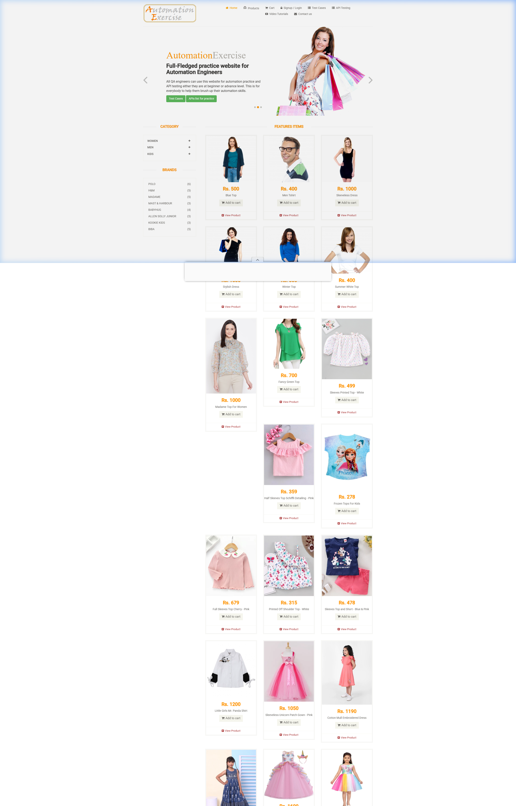

# Professional QA Automation Framework - Cypress & TypeScript

**English 🇺🇸** | [Español 🇪🇸](README.es.md)

## 🌟 Featured Project: Multi-Browser E2E Suite

This repository showcases a **production-grade E2E and API automation suite** designed for scalability and resilience. It validates critical business flows for [Automation Exercise](https://automationexercise.com/) using industry-standard engineering patterns.

---

## 🎯 Testing Strategy

The framework prioritizes critical business flows using a layered validation strategy:

- **E2E Tests** for complete, high-value user journeys.
- **API Tests** for backend validation and early failure detection (Shift-Left approach).
- **Mobile & Responsive Validation** to ensure UI integrity across different devices.
- **Cross-browser execution** to ensure rendering and functional consistency.
- **Independent & Atomic Tests** to avoid shared state dependencies and ensure reliable sequential execution.
- **Deterministic Synchronization** using network interception (`cy.intercept`) instead of static waits.

---

## 🚀 Key Engineering Features

*   **Page Object Model (POM) Architecture:** Strict separation of test logic from UI interaction layers.
*   **Hybrid UI + API Validation:** Comprehensive coverage including interface flows and independent REST endpoint validation.
*   **Cross-Browser Capability:** Suite runs on **Chrome, Firefox, and Edge** with sequential browsers (third-party site with shared users; workflow keeps `max-parallel: 1`).
*   **Mobile & Responsive Testing:** Support for validations across different **Viewports** (Mobile, Tablet, Desktop).
*   **Dynamic Data Generation:** Integration with **Faker.js** for realistic and varied test scenarios.
*   **Dynamic Test State Recovery:** Resilience mechanism that automatically restores user states (login/registration) if altered by previous runs.
*   **Network Interception:** Direct control over XHR/Fetch traffic for precise synchronization.
*   **Enterprise CI/CD Pipeline:** Integrated with GitHub Actions using a Matrix Strategy for sequential browser execution (`max-parallel: 1`).

---

## 🧪 Automated Coverage (42 Scenarios: 14 API + 28 E2E)

Measured with `node scripts/count-tests.mjs` (counts `it(` per folder under `cypress/e2e`):

| Area (`cypress/e2e` folder) | Specs | Scenarios (`it`) | Type |
| :--- | :---: | :---: | :---: |
| `api` | 1 | 14 | Backend |
| `auth` | 2 | 5 | UI / E2E |
| `cart` | 2 | 5 | UI / E2E |
| `checkout` | 1 | 5 | UI / E2E |
| `products` | 3 | 5 | UI / E2E |
| `ui` | 5 | 8 | UI / E2E |
| **Total** | **14** | **42** | — |

---

## 💡 Engineering Decisions & Best Practices

*   **Cross-Browser Insights:** Sequential execution uncovered rendering and synchronization inconsistencies specific to **Firefox**, validating the effectiveness of the multi-browser strategy.
*   **Scalable Locators:** Priority use of `data-qa` attributes to ensure test stability.
*   **Third-Party Noise Reduction:** Strategic use of `blockHosts` to mitigate flaky ad-trackers on the third-party site (no speedup percentage claimed: measuring it would require repeated full-suite runs).
*   **Deterministic Testing:** Replaced fixed `cy.wait(N)` with network-aliasing to ensure tests only proceed when requests resolve.

---

## 📸 Framework Execution Evidence

### CI/CD Pipeline (GitHub Actions - Matrix Execution)

*Sequential execution across Chrome, Firefox, and Edge browsers (`max-parallel: 1`; sequential browsers because it runs against a third-party site with shared users).*

### Full Test Suite Results (42 Scenarios: 14 API + 28 E2E)

*Example suite output across E2E and API layers (no pass-rate claim: it would require repeated full runs across browsers).*

### Test Execution & UI Validation

*Automated validation of critical flows on the [Automation Exercise](https://automationexercise.com/) platform.*

> [!TIP]
> You can find a full video execution of the authentication suite in [docs/img/execution.mp4](docs/img/execution.mp4).

---

## ⚙️ CI/CD Workflow

The suite runs automatically on:
*   **Push** to main branches.
*   **Pull Requests**.
*   **Scheduled Runs:** Every Monday at 08:00 AM UTC.
*   **Manual Runs:** `workflow_dispatch` (Actions tab -> "Cypress E2E Multi-Browser Tests" -> Run workflow).

Concurrency: `cypress-${{ github.ref }}` with `cancel-in-progress: false`, so queued runs wait instead of overlapping on the shared third-party site.

> [!NOTE]
> GitHub automatically disables scheduled workflows after 60 days without repository activity. If the Monday run stops firing, re-enable it with `gh workflow enable cypress.yml -R Arrobajean/cypress-portafolio` (or the Actions UI) and push any commit to resume the schedule.

---

## ▶️ Local Execution

1.  **Clone:** `git clone https://github.com/Arrobajean/cypress-portafolio.git`
2.  **Install:** `npm install`
3.  **UI Mode:** `npm run cypress:open`
4.  **Headless:** `npm run test`

---

## 👨‍💻 About the Author

**Jean** — *QA Automation Engineer*

Focused on building scalable E2E frameworks, API testing, and CI/CD automation using Cypress and TypeScript. Committed to software quality and resilient automation architectures.

[LinkedIn](https://www.linkedin.com/in/jeancastanedah/) | [GitHub](https://github.com/Arrobajean)
